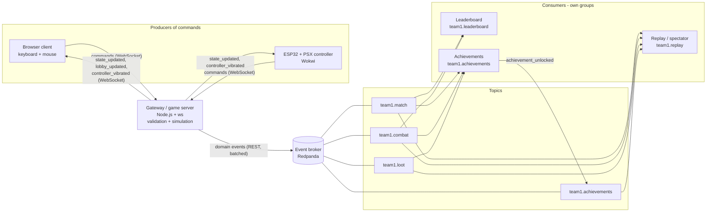

# Technical Design – Neon Zone Royale

## 1. Tech stack

| Layer | Technology | Why |
|-------|-----------|-----|
| Gateway / game server | **Node.js** (ES modules) + `ws` | Event-driven, simple WebSocket server |
| Client → gateway | **WebSocket**, JSON commands | Low latency, works in browser and on ESP32 |
| Event broker | **Redpanda** (Kafka-compatible) via **REST proxy** (`https://edp-broker.codewithpeter.com`) | Required event-driven backbone |
| Consumers | Node.js scripts using the REST proxy | Independent services, one group each |
| Web client | **HTML5 Canvas**, plain JavaScript | Small 2D top-down browser game |
| Hardware controller | **ESP32** + **PSX (PS2) controller** simulated in **Wokwi** (Arduino C++) | Alternative input device |
| Config / secrets | `.env` + `dotenv` (`.env` is in `.gitignore`) | Broker password never committed |
| Tools | Git/GitHub, Node 20+ | Teamwork |

## 2. Architecture: producers → gateway → broker → consumers



Plain-text version:

```
 Browser ─┐                                         ┌─► Leaderboard  (team1.leaderboard)
          ├─ commands (WebSocket) ─► GATEWAY ─ events (REST, batched) ─► BROKER ─┼─► Achievements (team1.achievements) ─► publishes achievement_unlocked
 ESP32  ──┘                      ◄─ state (WebSocket)                            └─► Replay       (team1.replay)
```

### Two paths on purpose

| Path | Used for | Why |
|------|----------|-----|
| **WebSocket (gateway ↔ clients)** | `move`, `aim`, `fire_weapon`, `state_updated` (30–60 Hz) | Needs low latency; too frequent for the broker |
| **Broker (gateway → topics → consumers)** | Domain events: `player_eliminated`, `zone_shrunk`, `loot_picked_up`, `match_ended`, … | Decoupled consumers, replayable log, easy to extend |

### Gateway modules

- **Connection manager** – accepts WebSockets, parses commands, rate-limits (60 msg/s).
- **Lobby** – 2–8 players, starts the match when everybody is ready.
- **Match / game loop** – fixed 60 ticks/s simulation, snapshot every 3rd tick (20 Hz); movement, bullets, damage, zone phases, loot.
- **Event publisher** – a queue; every ~200 ms it sends **all waiting events in one request** to the broker (`POST /topics/<topic>` per topic), one request at a time. Failures are retried; the game never blocks on the broker.

### Broker topics

| Topic | Events |
|-------|--------|
| `team1.match` | `player_joined`, `player_ready_changed`, `controller_connected`, `match_started`, `zone_shrunk`, `player_left`, `match_ended` |
| `team1.combat` | `weapon_fired`, `player_damaged`, `player_eliminated` |
| `team1.loot` | `loot_spawned`, `loot_picked_up`, `item_used`, `player_healed` |
| `team1.achievements` | `achievement_unlocked` (produced by the achievements consumer) |

Full list with payloads: [`game_events.md`](game_events.md).

### Consumers (each team member owns at least one)

| Consumer | Owner | Group | Reads | Result |
|----------|-------|-------|-------|--------|
| Leaderboard | Student 1 | `team1.leaderboard` | `team1.match`, `team1.combat` | Kills and wins table (rebuilt from the log) |
| Achievements | Student 2 | `team1.achievements` | `team1.combat`, `team1.loot`, `team1.match` | Publishes `achievement_unlocked` |
| Replay / spectator | Student 3 | `team1.replay` | all `team1.*` | Stored timeline of each match |

Consumer rules: own group per consumer, `auto.offset.reset = earliest`, poll with `timeout=1000`, retry on `50003 network_exception`.

### Event flow example (a kill)

```
Client           Gateway                         Broker topic           Consumers
 | fire_weapon ─►|
 |               | validates, simulates bullet
 |               | ─ weapon_fired ───────────────► team1.combat ────────► achievements, replay
 |               | bullet hits player 9
 |               | ─ player_damaged ─────────────► team1.combat ────────► achievements, replay
 |               | hp = 0
 |               | ─ player_eliminated ──────────► team1.combat ────────► leaderboard (+1 kill),
 |               |                                                        achievements (first_blood?), replay
 |◄ state_updated| (WebSocket, 20 Hz, not via broker)
```

## 3. Project structure

```
neon-zone-royale/
├── README.md  concept.md  game_events.md  tech_design.md
├── .env.example            # BROKER_URL, BROKER_USER, BROKER_PASSWORD (real .env is ignored by git)
├── package.json
├── server/                 # gateway + game simulation + broker publisher
│   └── index.js
├── client/
│   └── index.html          # canvas client
├── consumers/
│   ├── leaderboard.js
│   ├── achievements.js
│   └── replay.js
└── controller/
    ├── wokwi/ (diagram.json, wokwi.toml)
    └── firmware/main.ino
```

## 4. Controllers

All devices send the **same commands** (`move`, `aim`, `fire_weapon`, …), so the gateway doesn't care which device is used.

1. **Keyboard + mouse** – default web client (WASD, mouse aim, left click fire).
2. **ESP32 + PSX controller in Wokwi** – hardware input.

### Wokwi PSX controller

| PSX pin | ESP32 pin |
|---------|-----------|
| DATA | GPIO 19 |
| CMD | GPIO 23 |
| ATT | GPIO 5 |
| CLK | GPIO 18 |
| VCC / GND | 3V3 / GND |
| LED "hit" | GPIO 2 |
| LED "online" | GPIO 4 |
| Buzzer | GPIO 15 |

| PSX input | Command |
|-----------|---------|
| Left stick | `move` |
| Right stick | `aim` |
| R1 | `fire_weapon` |
| Cross (X) | `pickup_loot` |
| Triangle | `use_item` (medkit) |

On start the ESP32 sends `connect_controller` with the player id. When the gateway sends `controller_vibrated`, the hit LED blinks and the buzzer beeps.

```cpp
void loop() {
  ps2.read_gamepad();
  float dx = (ps2.Analog(PSS_LX) - 128) / 128.0;
  float dy = (ps2.Analog(PSS_LY) - 128) / 128.0;
  if (changed(dx, dy)) ws.sendTXT(cmd("move", dx, dy));
  float angle = atan2(ps2.Analog(PSS_RY) - 128, ps2.Analog(PSS_RX) - 128);
  ws.sendTXT(cmd("aim", angle));
  if (ps2.ButtonPressed(PSB_R1)) ws.sendTXT(cmd("fire_weapon", angle));
}
void onMessage(String event) { if (event == "controller_vibrated") { digitalWrite(LED_HIT, HIGH); tone(BUZZER, 800, 100); } }
```

## 5. Security and reliability

- Authoritative gateway: clients send only commands; position, HP and damage are never trusted.
- Rate limit 60 msg/s, max message size 2 KB; refused commands get `command_rejected`.
- Broker password only in `.env` / environment variable, never in git or docs.
- If the broker is slow or down, the game keeps running; events wait in the publisher queue and are retried.

## 6. Testing

- Open two browser tabs and play a full match (join, ready, fight, win).
- Check topics: `curl -u team1:$BROKER_PASSWORD https://edp-broker.codewithpeter.com/topics`.
- Run each consumer and verify it reacts (leaderboard table, achievements published, replay file created).
- Test the Wokwi controller against the local gateway.

## 7. Plan

| When | Goal |
|------|------|
| Round 1 (today 15:00) | Playable game, batched publishing to broker, leaderboard consumer working |
| Round 2 (today 20:00) | Achievements and replay consumers, loot events |
| Final (Mon 16 Nov 20:00) | Obstacles, Wokwi controller, polish, stable demo |

## 8. Risks

| Risk | Mitigation |
|------|------------|
| Broker latency (100–250 ms per request) | Batch events, one request at a time, no movement through the broker |
| Consumer creation fails with `50003` | Retry loop for the first ~15 s |
| Wokwi network limits | Fallback: controller sends via Serial to a small bridge script |
| Not everyone commits | Split work by consumer; each member commits their own consumer |
